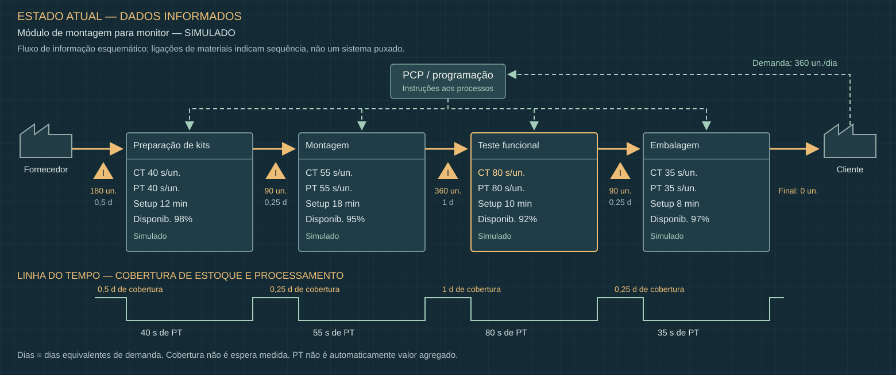

# VSM Lab — Qualidade que se Aplica

Ferramenta educacional e artigo técnico de **Wanderley Uchôa** para profissionais de Qualidade, NPI, produção e Dados Industriais.

**[Experimentar a ferramenta](https://vsm-lab-qualidade-que-se-aplica.rednote512.chatgpt.site/)** · **[Ler o artigo](https://vsm-lab-qualidade-que-se-aplica.rednote512.chatgpt.site/artigo)**

## Recursos

- Rota sequencial editável com 2–8 processos.
- CT, PT, setup, disponibilidade, estoques, origem e referência de coleta.
- Takt, cobertura, processamento e lead time observado separados.
- Estado atual e futuro proposto independentes.
- Projeto JSON, mapa SVG, tabela CSV e impressão.
- Cópia local no navegador, sem conta ou chave de API.

O site hospedado e este repositório são destinos independentes: commits aqui não atualizam o site automaticamente.

## Exemplo simulado



| Entrada / resultado | Valor |
|---|---:|
| Tempo líquido | 420 min/dia |
| Demanda | 360 un./dia |
| Takt | 70 s/un. |
| Estoque registrado | 720 un. |
| Cobertura | 2 dias equivalentes de demanda |
| Processamento total | 210 s/un. |
| CT do teste funcional | 80 s/un. |
| Lead time observado | Não informado |

Dados inteiramente simulados. CT acima do takt indica uma comparação a investigar sob as premissas do exercício, não prova de capacidade efetiva. Reduzir uma entrada no futuro proposto não demonstra implementação.

## Executar

Requisito: Node.js 22.9 ou superior.

```bash
npm ci
npm test
npm start
```

Abra `http://127.0.0.1:4173/`. O comando `npm run build` gera a distribuição estática em `dist/`. Não há bibliotecas externas de produção.

## Estrutura

```text
vsm-lab/
├── .github/workflows/testes.yml
├── docs/
│   ├── guia-instalacao.md
│   ├── arquitetura.md
│   ├── artigo-vsm.txt
│   └── legenda-linkedin.txt
├── src/
│   ├── components/botao.js
│   ├── domain/vsm.js
│   ├── styles/estilo.css
│   └── index.js
├── tests/
│   ├── botao.test.js
│   └── vsm.test.js
├── scripts/
│   ├── build.js
│   └── serve.js
├── public/exemplo-vsm.svg
├── index.html
├── artigo.html
├── .env.example
├── .gitignore
├── CONTRIBUTING.md
├── LICENSE
├── package.json
├── package-lock.json
└── README.md
```

## Documentação

- [Guia de instalação](docs/guia-instalacao.md)
- [Arquitetura, dados e cálculos](docs/arquitetura.md)
- [Artigo completo: VSM na prática](docs/artigo-vsm.txt)
- [Legenda de divulgação](docs/legenda-linkedin.txt)
- [Regras de contribuição](CONTRIBUTING.md)

As fotos que inspiraram a pauta não são reproduzidas. Dados e exemplo não descrevem uma organização real.

## Limites e fontes

Cobertura não é espera observada. PT não é automaticamente valor agregado. O aplicativo não simula filas, não calcula OEE, PCE, ROI ou capacidade efetiva e não libera produto. Rotas alternativas, recursos paralelos, lotes e retrabalho exigem tratamento adicional.

Referências conceituais primárias:

- [Lean Enterprise Institute — Value Stream Mapping](https://www.lean.org/lexicon-terms/value-stream-mapping/)
- [Lean Enterprise Institute — Takt Time](https://www.lean.org/lexicon-terms/takt-time/)
- [Lean Enterprise Institute — Cycle Time](https://www.lean.org/lexicon-terms/cycle-time/)

## Testes

```bash
npm run check
```

GitHub Actions executa testes e build em Node.js 22 e 24 nos pushes para `main` e pull requests. O workflow não realiza publicação automática. Consulte as execuções em Actions para verificar o resultado remoto.

## Licença

[MIT](LICENSE). Copyright © 2026 Wanderley Uchôa. Preserve a autoria e o texto da licença nas cópias distribuídas.
